<p align="center">
  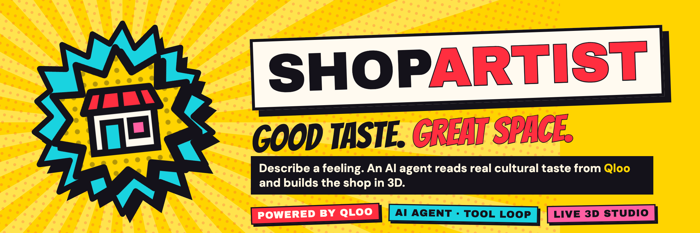
</p>

<div align="center">
  <h1>SHOPARTIST</h1>
  <p><strong>An AI design agent that turns a shop owner's feeling into a real, buildable 3D interior, grounded in what people with that taste actually love, via Qloo.</strong></p>
  <p>
    <a href="https://k2cmgsjmnkueye2dargcqkb5n40gpuqg.lambda-url.us-east-1.on.aws/"></a>
    <a href="submission/submission-description.md"></a>
    <a href="https://qloo.devpost.com/"></a>
  </p>
  <p>
    <a href="LICENSE"></a>
    
    
    
    
    
    
  </p>
  <p>
    
    
    
    
    
    
  </p>
  <p>
    <a href="submission/submission-description.md">Submission</a> ·
    <a href="#-how-it-works">How it works</a> ·
    <a href="#-what-qloo-does-here">Qloo</a> ·
    <a href="#-architecture">Architecture</a> ·
    <a href="#-run-locally">Run locally</a> ·
    <a href="#-deploy-to-aws">Deploy</a>
  </p>
  <p><sub>Name the idea → Qloo reads the taste → the agent drafts four directions → build it in 3D → keep editing with the sidekick</sub></p>
</div>

> [!IMPORTANT]
> ShopArtist produces **conceptual** shop layouts from real Qloo signals. It is not CAD or building-code certification. Qloo affinities are aggregate cultural signals, not foot traffic or sales. The live demo is capped at 200 AI actions in total, because the model provider cannot rate-limit per key.

<details>
<summary><kbd>Contents</kbd></summary>

- [At a glance](#-at-a-glance)
- [The problem](#the-problem)
- [See the product](#see-the-product)
- [How it works](#-how-it-works)
- [What Qloo does here](#-what-qloo-does-here)
- [Seven things ShopArtist does](#seven-things-shopartist-does)
- [The asset catalog and the asset agent](#the-asset-catalog-and-the-asset-agent)
- [Architecture](#-architecture)
- [Run locally](#-run-locally)
- [Deploy to AWS](#-deploy-to-aws)
- [Verify](#verify)
- [Truth boundaries](#truth-boundaries)
- [Repository map](#repository-map)
- [License](#license)

</details>

## 🎨 At a glance

<table>
  <tr>
    <td width="25%" align="center"><strong>01 / IDEA</strong><br><br>Name the shop, mix books, coffee, fashion, art or your own idea, and say why it exists.</td>
    <td width="25%" align="center"><strong>02 / TASTE</strong><br><br>City, vibe, inspiration. The agent asks Qloo what people with that taste actually love.</td>
    <td width="25%" align="center"><strong>03 / DIRECTIONS</strong><br><br>Four genuinely different interiors, each decision citing the Qloo signal behind it.</td>
    <td width="25%" align="center"><strong>04 / BUILD</strong><br><br>A live 3D shop you can orbit, edit and talk to, with every change checked.</td>
  </tr>
</table>

<p align="center">
  
</p>

## The problem

A new shop is a bet on taste. The owner knows the *feeling* they want, a place where neighbours linger and discover something new, but turning that into a room takes a designer most small shops cannot afford. Ask a generic AI and you get the average of the internet: neutral tones, a few plants, Edison bulbs. It looks fine. It looks like every other shop.

ShopArtist asks a narrower question:

> Can a shop owner describe a feeling and get a buildable interior grounded in what *their* crowd actually loves?

## See the product

Every screenshot below is a full-resolution frame from a screen recording of the real app, or the live asset catalog.

| Landing | Step 1 · the idea | Step 2 · Qloo search |
| --- | --- | --- |
| 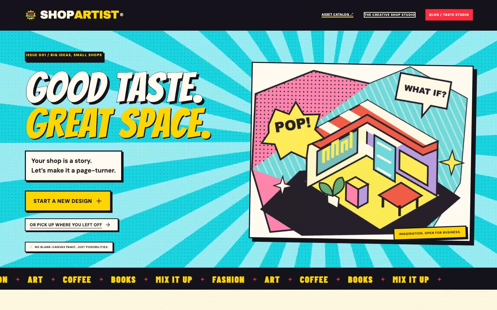 | 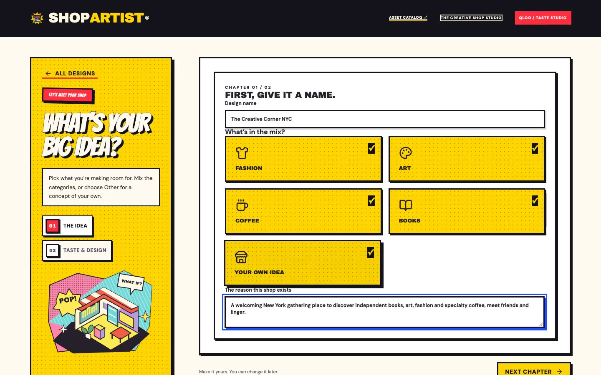 | 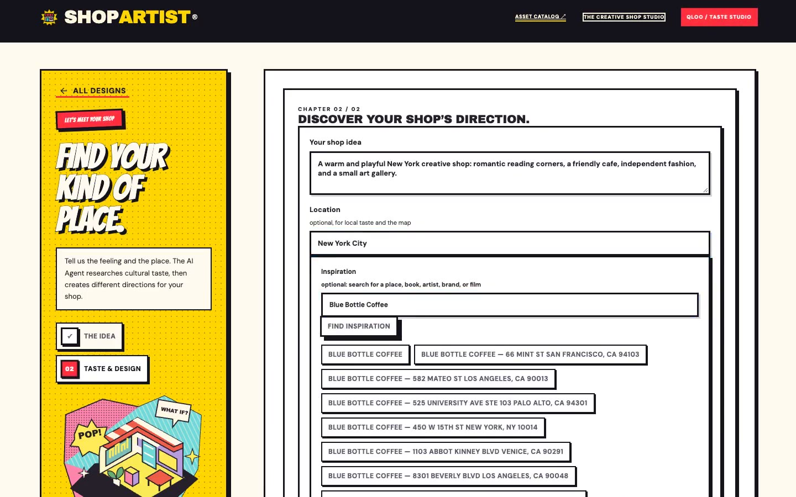 |
| A Pop Art front door into a guided, two-step brief. | The shop's mix and its reason to exist. | Qloo resolves an inspiration to real places. |

| The agent at work | Four directions | Places and the taste map |
| --- | --- | --- |
| 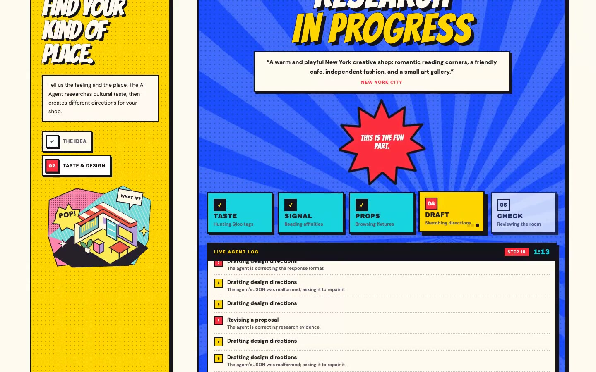 | 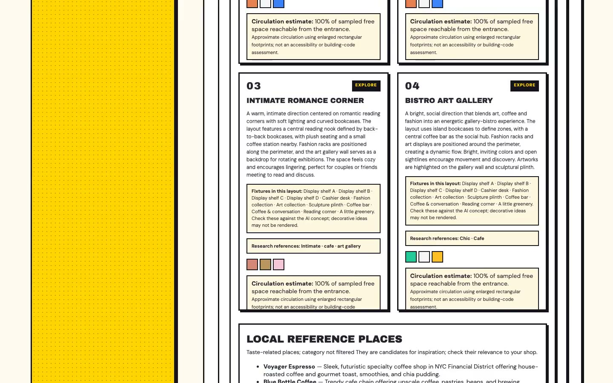 | 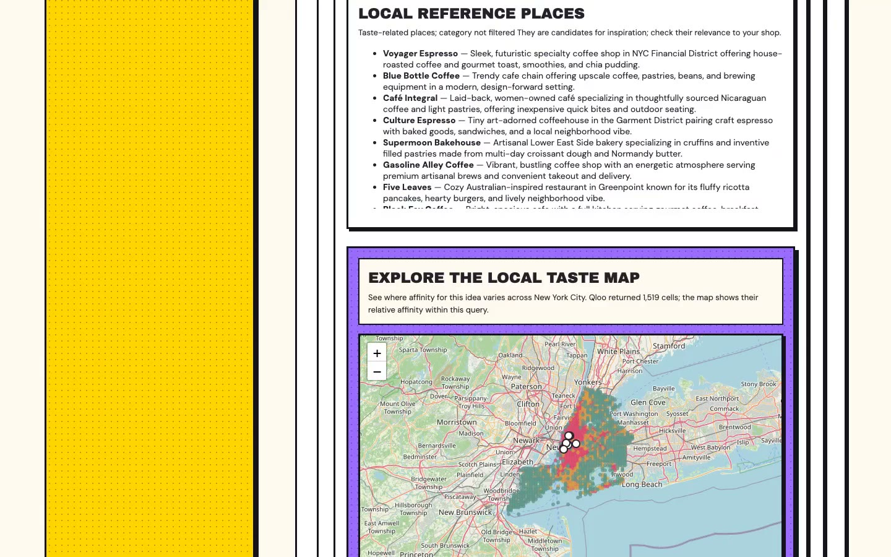 |
| Progress streams live: steps, tool calls, checks. | Each card shows its fixtures and its Qloo references. | Taste-ranked places and where the taste clusters. |

| Build | The live 3D studio | The AI sidekick |
| --- | --- | --- |
| 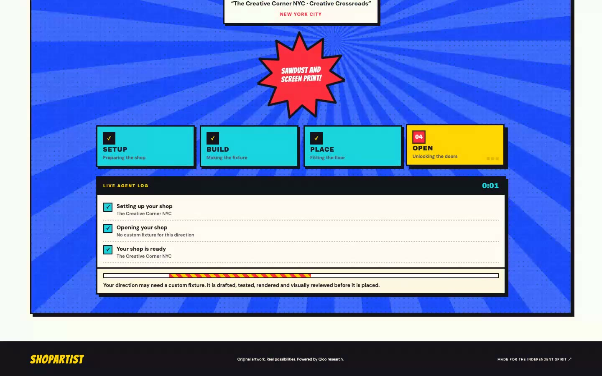 | 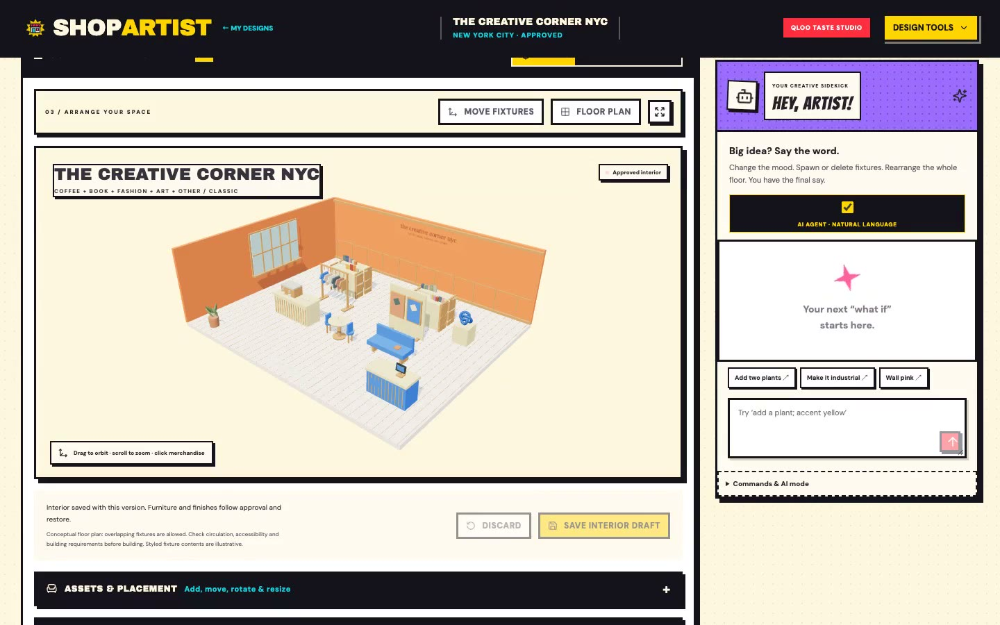 | 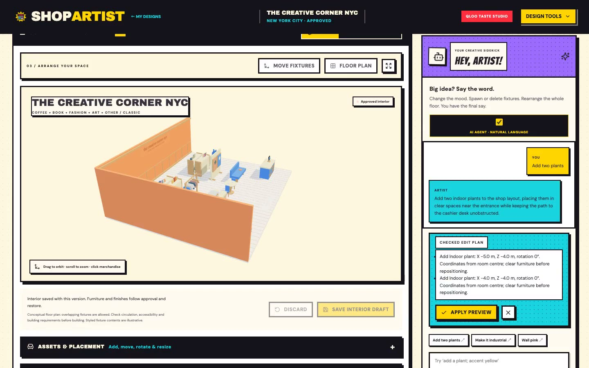 |
| One click from direction to shop. | Orbit, move, recolour, floor plan, versions. | Plain-language edits, validated before they apply. |

| Asset catalog | Cultural library | Version history |
| --- | --- | --- |
| 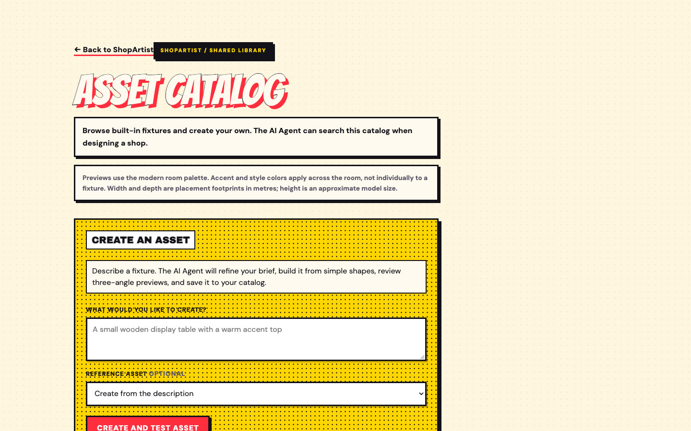 | 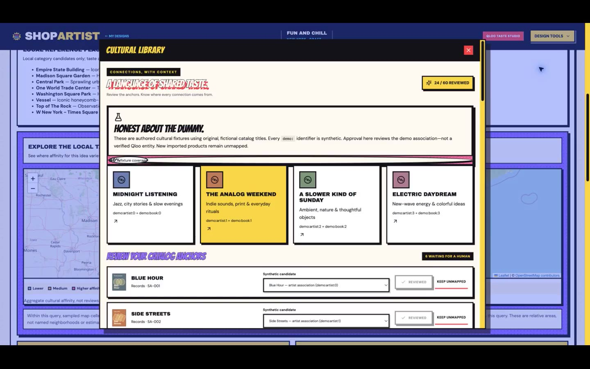 | 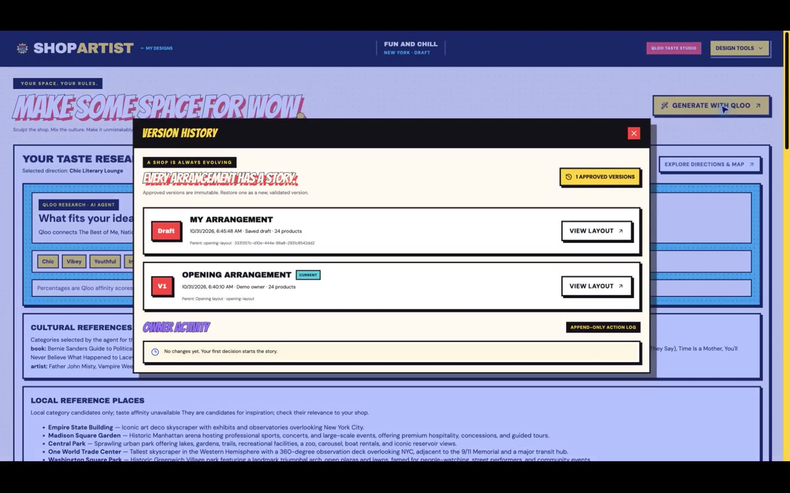 |
| 210 fixtures, and a form to create new ones. | Catalog anchors reviewed by a human. | Approved versions are immutable and restorable. |

## 🧠 How it works

<p align="center">
  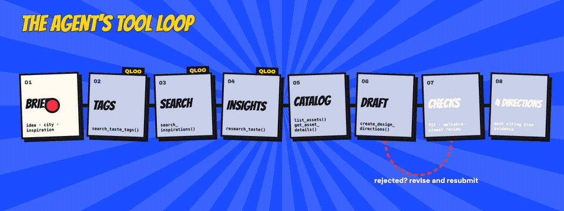
</p>

| Stage | Tool / step | What happens | What cannot happen silently |
| --- | --- | --- | --- |
| **Brief** | (input) | Idea, purpose, location and inspirations arrive as data. | The brief is never treated as instructions. |
| **Taste tags** | `search_taste_tags` → Qloo `/v2/tags` | 2–3 precise tags: ambience, décor, genre, place categories. | Tag IDs must come from Qloo's results. |
| **Inspirations** | `search_inspirations` → Qloo `/search` | Named places, artists, brands resolve to real entities. | A candidate is used only on a clear match. |
| **Insights** | `research_taste` → Qloo `/v2/insights` | Cross-domain affinities, taste-ranked places in the radius, `urn:heatmap`. | Scores are shown as affinities, never ratings or sales. |
| **Catalog** | `list_assets` · `get_asset_details` | Browses 210 fixtures with real footprints and colour behaviour. | Only inspected assets can be added. |
| **Draft** | `create_design_directions` | Moves, additions, palette, window, decisions with evidence IDs. | Evidence IDs Qloo did not return are stripped. |
| **Checks** | server + vision review | In bounds, no overlaps, entrance reachable, not a duplicate; three-view render reviewed. | A rejected proposal returns with the exact reason and is revised. |

The loop is built for a model that makes mistakes: long UUIDs are shown as short aliases and mapped back, failed calls are pruned from history so the model does not copy them, near-miss values are normalised, overlapping items move to the nearest free spot, and malformed JSON is repaired by the parser or by one tool-free repair call.

## 🔴 What Qloo does here

<p align="center">
  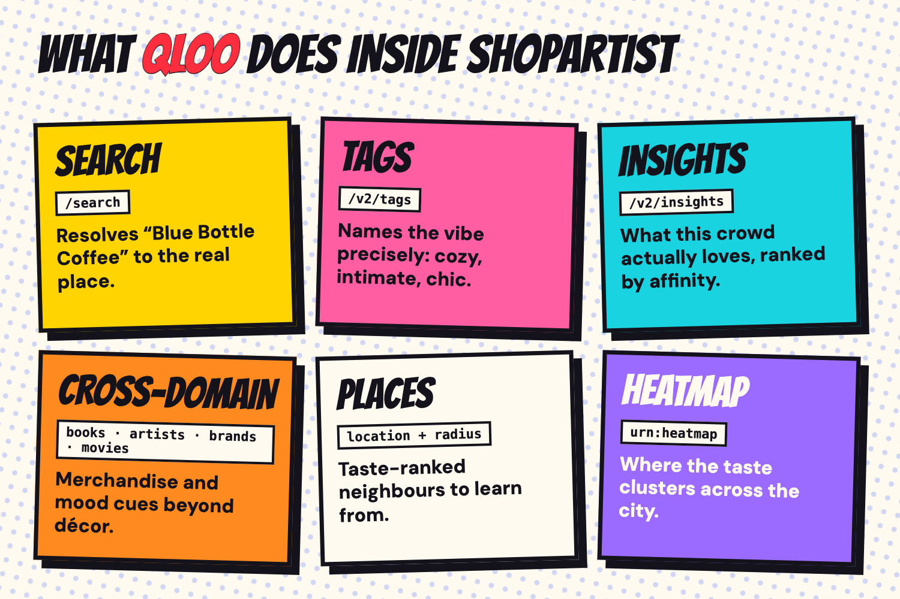
</p>

| Qloo capability | Endpoint | Used for |
| --- | --- | --- |
| **Search** | `/search` | Resolving an owner's inspiration ("Blue Bottle Coffee") to real entities. |
| **Tags** | `/v2/tags` | Naming the vibe precisely, and finding place categories. |
| **Insights** | `/v2/insights` | Ranked affinities for the chosen tags and location. |
| **Cross-domain** | insights with `urn:entity:book`, `artist`, `brand`, `movie` | Mood and merchandise cues beyond décor. |
| **Places** | insights with `urn:entity:place`, `filter.location` + radius | Taste-ranked local references to learn from. |
| **Heatmap** | insights with `urn:heatmap` | The interactive map of where the taste clusters. |

All calls go to `https://hackathon.api.qloo.com` from the server (`server/qloo.ts`); the key never reaches the browser. In the recorded run, the idea *"a warm and playful New York creative shop: romantic reading corners, a friendly café, independent fashion and a small art gallery"* returned the tags *Casual, Intimate, Authentic, Cozy, Trendy, Inviting, Chic, Bustling*, real reference places such as Voyager Espresso and Café Integral, and a heatmap of 1,519 cells.

## Seven things ShopArtist does

| | Capability | What the owner gets | How it is built |
| --- | --- | --- | --- |
| ✏️ | **Guided brief** | Name, mix, reason, vibe, city, inspiration in two short steps. | `src/Workspace.tsx`, `src/TasteStudio.tsx` |
| 🔴 | **Qloo-grounded research** | Real taste signals, places and a heatmap for the idea. | `server/design-agent.ts`, `server/qloo.ts` |
| 🃏 | **Four distinct directions** | Different styles, palettes, windows and shelf formations, each citing evidence. | Distinct-style assignment, preset formations, duplicate-room check |
| 🏗️ | **Build** | The direction becomes the shop, optionally with a new custom fixture. | `server/design-build.ts`, streamed over SSE |
| 🧊 | **Live 3D studio** | Orbit, move, rotate, recolour, floor plan, autosaved drafts, approved versions. | three.js in `src/ShopScene.tsx`, `src/RoomEditor.tsx` |
| 💬 | **AI sidekick** | "Rearrange and add 8 bookshelves" spawns, deletes and moves real fixtures. | `server/agent.ts`, validated command schema |
| 🪑 | **Asset agent** | New fixtures drafted, tested, rendered and reviewed, then reusable as references. | `server/asset-creator.ts`, `server/asset-review.ts` |

<table>
  <tr>
    <td width="50%">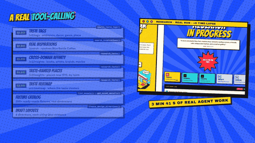<br><sub><strong>The agent.</strong> Each Qloo call lights up as the real run plays at ×9.</sub></td>
    <td width="50%">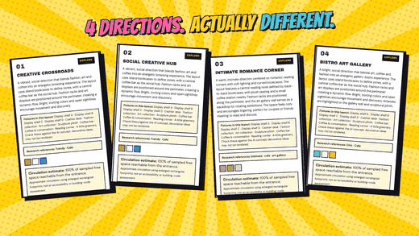<br><sub><strong>Evidence.</strong> Qloo evidence in red, AI interpretation in blue.</sub></td>
  </tr>
  <tr>
    <td width="50%">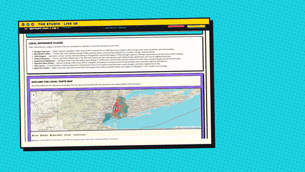<br><sub><strong>The studio.</strong> Plain-language edits, checked before they land.</sub></td>
    <td width="50%">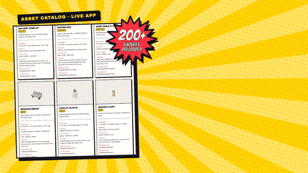<br><sub><strong>The catalog.</strong> 200+ fixtures, and new ones on request.</sub></td>
  </tr>
</table>

## The asset catalog and the asset agent

ShopArtist ships **210 preloaded fixtures**: nine original fixtures and 201 curated references covering cafés, fashion, art, bookshops, seating and displays. Each entry in `shared/assets/` records its shape, footprint, purpose, mood tags and colour behaviour, so the agent works from concrete examples. Browse them at `/asset-catalog.html`.

**Create an asset** takes a description and, optionally, an existing fixture as a reference. The asset agent then:

1. inspects the reference and refines the brief,
2. drafts a model from boxes and vertical cylinders (no model-written code is executed),
3. tests construction and bounds,
4. renders front, side and three-quarter views,
5. sends them to a vision reviewer and revises (up to three reviews),
6. saves it, ready to be placed or used as a reference for the next one.

`npm run mcp:assets` exposes the same catalog over the **Model Context Protocol** (`list_assets`, `inspect_asset`, `preview_asset`, `save_asset`) for compatible local clients.

## 🏗 Architecture

<p align="center">
  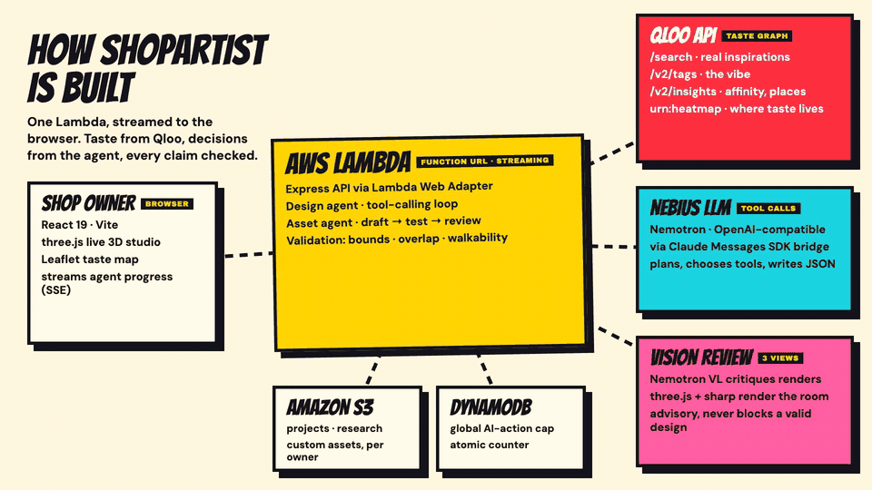
</p>

| Layer | Responsibility |
| --- | --- |
| **Browser** · React 19, Vite, three.js, Leaflet | Pop Art UI, live 3D studio, taste map; reads agent progress from a Server-Sent Events stream. |
| **AWS Lambda** · Express via the Lambda Web Adapter | One function serves the site and the API behind a streaming Function URL (15-minute timeout for long agent runs). |
| **Design agent** · Claude Messages SDK → OpenAI-compatible bridge | The tool-calling loop above, with server-side validation of every tool call. |
| **Qloo API** | Search, tags, insights, places, heatmap. |
| **Nebius AI Studio** | Nemotron for reasoning and tool calls, Nemotron VL for visual review. |
| **Amazon S3** | Each owner's projects, research studies and custom assets, loaded and written back per request. |
| **Amazon DynamoDB** | An atomic, global counter capping AI actions on the public demo. |

Locally everything runs on one Node process with built-in SQLite; in the cloud the same code keeps SQLite in memory and `server/cloud.ts` persists each user's rows to S3.

## ⚡ Run locally

Requires **Node.js 24+** (built-in SQLite) and npm.

```sh
npm ci
npm run dev        # Vite on :5173, API on 127.0.0.1:4317
```

Create `.env` (in the project folder or its parent):

```sh
QLOO_API_KEY=...          # from the Qloo hackathon developer guide
AGENT_API_KEY=...
AGENT_BASE_URL=https://api.tokenfactory.nebius.com/v1/
AGENT_MODEL=...          # a tool-capable model
AI_VISION_MODEL=...       # optional, default nvidia/Nemotron-3.5-Super-VL
```

Single-server build: `npm run build && npm start`, then open `http://127.0.0.1:4317`.

| Variable | Default | Purpose |
| --- | --- | --- |
| `HOST` | `127.0.0.1` | Bind address |
| `PORT` | `4317` | API and single-server port |
| `DATA_DIR` | `./data` | SQLite directory (local mode) |
| `QLOO_API_KEY` | unset | Server-only Qloo credential |
| `AGENT_API_KEY` / `AGENT_BASE_URL` / `AGENT_MODEL` | unset | Agent model |
| `AI_VISION_MODEL` | `nvidia/Nemotron-3.5-Super-VL` | Visual reviewer |
| `STORE_BUCKET` | unset | Cloud mode: S3 bucket for persistence |
| `USAGE_TABLE` / `AGENT_USE_LIMIT` | unset / `200` | Cloud mode: global AI-action cap |

## ☁️ Deploy to AWS

```sh
deploy/aws-deploy.sh <aws-profile> <path/to/.env>     # idempotent; creates only shopartist-* resources
deploy/aws-teardown.sh <aws-profile>                   # removes them (deletes stored data)
```

The script builds the site, bundles the server with esbuild, installs `sharp` for Linux ARM, and creates or updates the Lambda (Node 24, ARM, Lambda Web Adapter, streaming Function URL), a private versioned S3 bucket, the DynamoDB usage table and a least-privilege IAM role. Secrets are read from the env file and never printed.

## Verify

```sh
npm test          # 48 tests: agent, planner, workflow, Qloo (mocked), asset creator, cloud persistence
npm run build
```

Automated tests mock Qloo and the model provider; they never call live services. Passing tests prove validation and wiring, not design quality; review the renders.

## Truth boundaries

- **Conceptual, not certified.** Layouts respect room bounds, overlaps and an approximate entrance path, but are not CAD, accessibility or building-code checks.
- **Qloo signals are aggregate.** Affinities describe cultural taste, not foot traffic, sales forecasts or individual preference.
- **Visual review is advisory.** It can be unavailable or wrong; inspect the three-view renders.
- **Synthetic merchandise.** The shelf-merchandising planner and its `demo:` mappings use synthetic sample data and say so.
- **Public demo limits.** 200 AI actions in total, anonymous cookie-based sandboxes, no production identity.

## Repository map

| Path | Purpose |
| --- | --- |
| [`src/`](src/) | React app: workspace, guided setup, research loader, studio, sidekick, Pop Art styles. |
| [`server/`](server/) | Express API, design agent, asset agent, Qloo client, model bridge, planner, cloud persistence. |
| [`shared/`](shared/) | Room model, validation, 210 asset definitions and renderers. |
| [`deploy/`](deploy/) | AWS deploy and teardown scripts. |
| [`submission/`](submission/) | Submission description, banner, diagrams, film GIFs, screenshots and gallery. |
| [`public/`](public/) | Logo, favicon and illustrations. |

## License

MIT. See [`LICENSE`](LICENSE). Map tiles © OpenStreetMap contributors. Qloo is a trademark of Qloo, Inc.; ShopArtist is an independent hackathon project. Dependency licenses remain with their authors.
